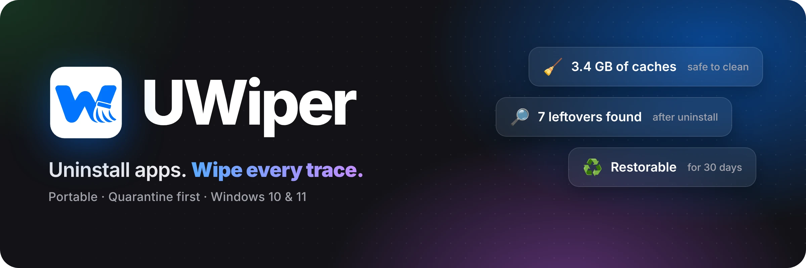
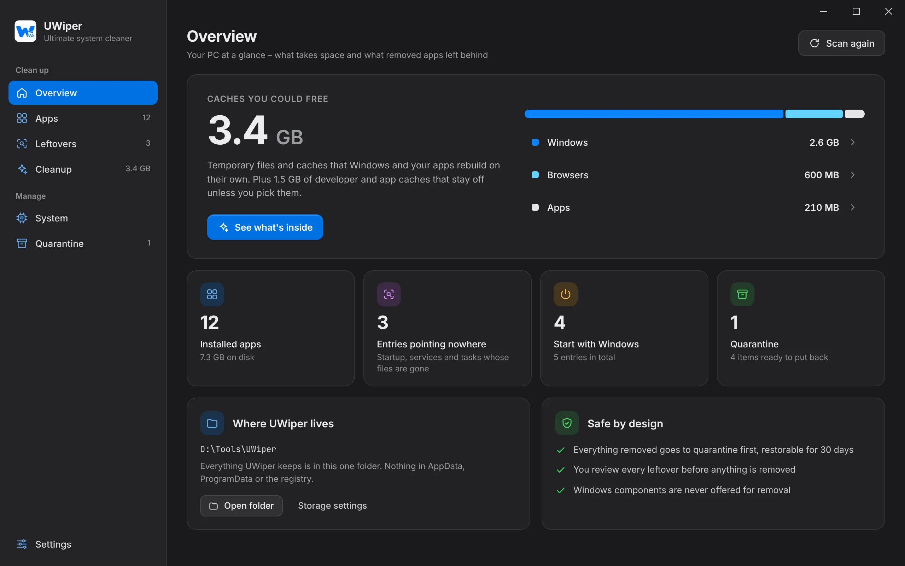
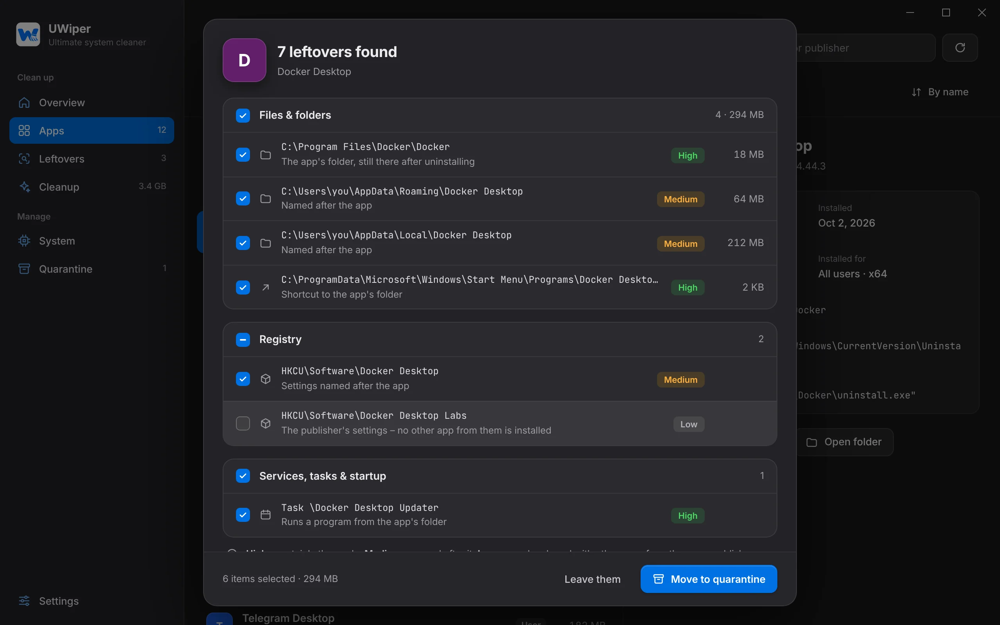
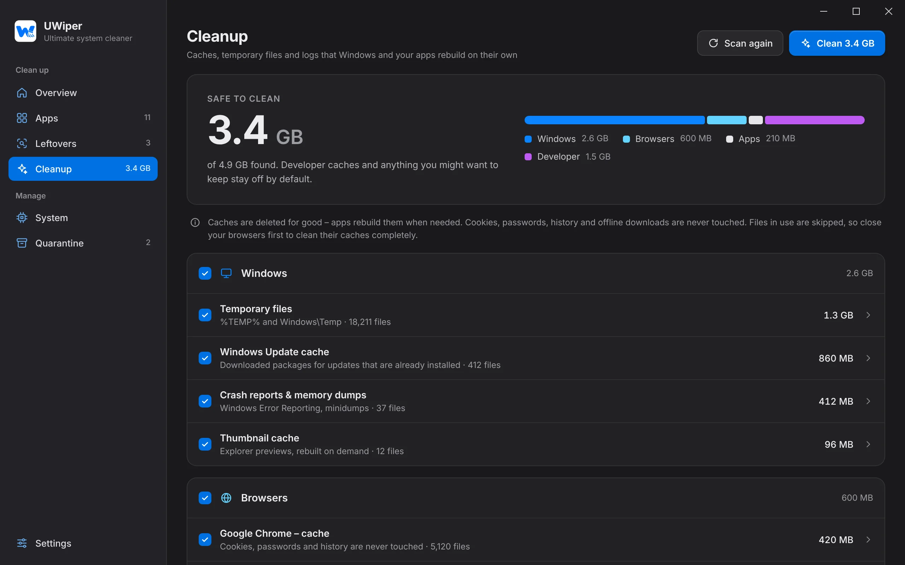
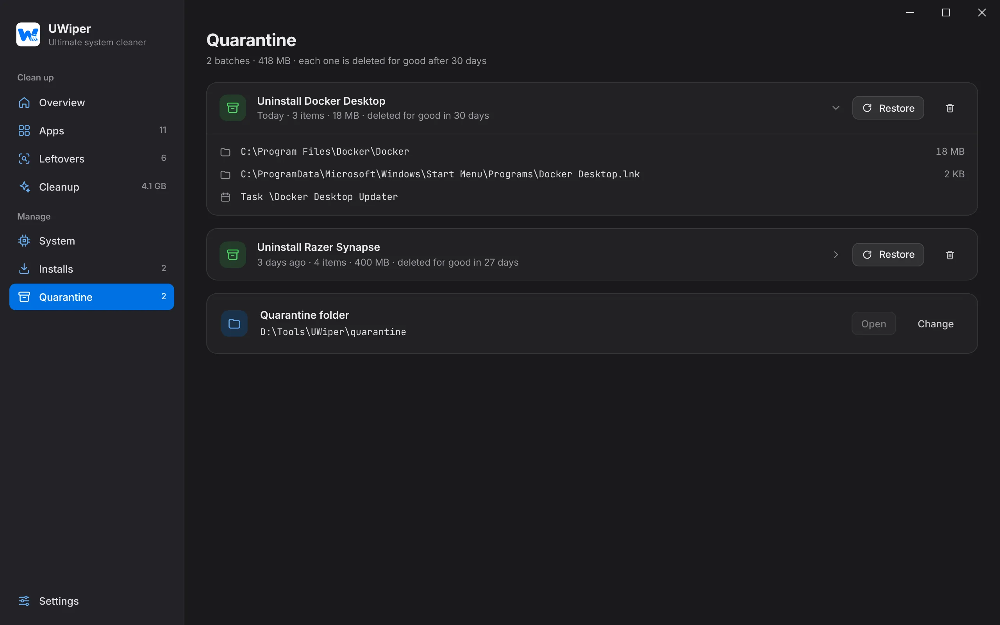
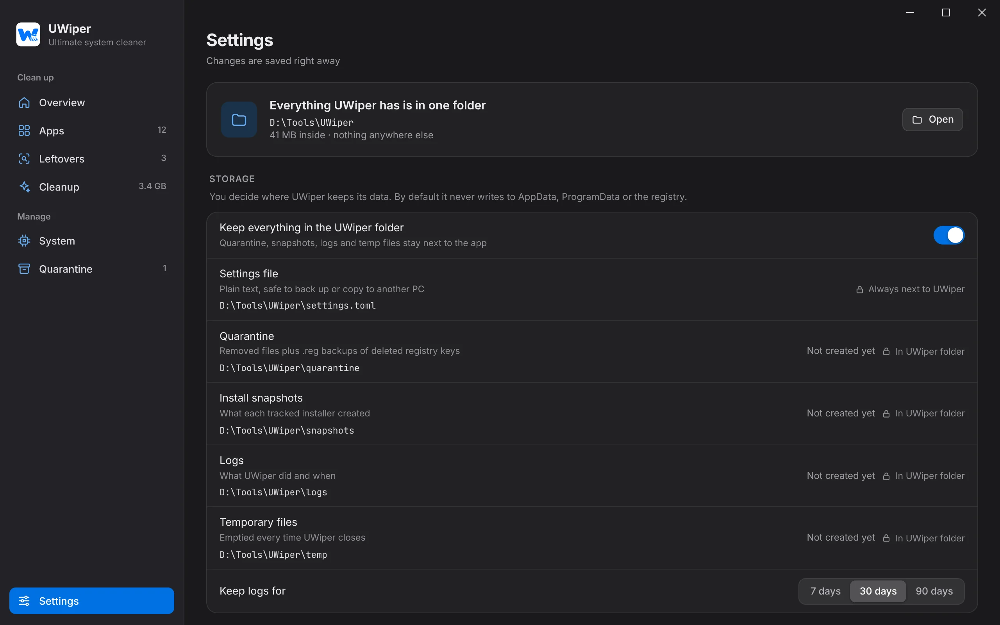

<p align="center">
  
</p>

<p align="center">
  <a href="https://github.com/danielsoren/uwiper/releases"></a>
  
  
  <a href="https://github.com/danielsoren/uwiper/actions/workflows/build.yml"></a>
  
</p>

<h3 align="center">Uninstalling an app shouldn't leave half of it behind. 🧹</h3>

<p align="center">
  UWiper runs an app's own uninstaller, then hunts down everything it left – folders, registry keys, services,<br>
  scheduled tasks, startup entries, shortcuts – and shows you the list before anything is touched.<br>
  Everything goes to quarantine first, so one click brings it all back.
</p>

<p align="center">
  <a href="https://github.com/danielsoren/uwiper/releases"><b>⬇️ Download</b></a> ·
  <a href="#-whats-inside"><b>✨ What's inside</b></a> ·
  <a href="#%EF%B8%8F-roadmap"><b>🗺️ Roadmap</b></a> ·
  <a href="#%EF%B8%8F-for-developers"><b>🛠️ Developers</b></a>
</p>

<p align="center">
  
</p>

## ✨ What's inside

|  |  |
| --- | --- |
| 🗑️ **Uninstall completely** | Runs the app's own uninstaller (MSI too), notices when it's done and scans for leftovers. A System Restore point first, if you like. |
| 🔎 **Leftovers, explained** | Every find says why it's there and how sure UWiper is: **High** – certainly the app's, **Medium** – named after it, **Low** – may be shared. You tick what goes. |
| ♻️ **Quarantine first** | Files are moved aside, registry keys and services exported to `.reg`, tasks saved as XML. Restore a whole batch in one click. Batches are deleted for good after 30 days (you choose). |
| 🧹 **Cache cleanup** | Temp files, Windows Update downloads, crash dumps, shader and thumbnail caches, browser caches, npm / pip / Cargo / NuGet / Gradle caches. Cookies, passwords and history are never touched. |
| 👻 **Entries pointing nowhere** | Startup entries, services and scheduled tasks whose programs are long gone – remove them in one go. |
| 🛡️ **Hard to break things with** | Windows and Microsoft components, shared folders, other apps' folders and your own "Never touch" list are always off limits. |
| 🎒 **Leaves no traces itself** | Fully portable: settings, quarantine, logs and even the WebView profile live next to the exe. Delete the folder and UWiper is gone. |

## 📸 A closer look

<table>
  <tr>
    <td width="50%"></td>
    <td width="50%"></td>
  </tr>
  <tr>
    <td align="center"><sub><b>Review leftovers</b> – grouped, sized, with confidence levels</sub></td>
    <td align="center"><sub><b>Clean caches</b> that apps rebuild anyway</sub></td>
  </tr>
  <tr>
    <td width="50%"></td>
    <td width="50%"></td>
  </tr>
  <tr>
    <td align="center"><sub><b>Quarantine</b> – put anything back in one click</sub></td>
    <td align="center"><sub><b>Settings</b> – you decide where everything lives</sub></td>
  </tr>
</table>

## 🚀 Get started

1. Grab **`UWiper.exe`** (or the portable zip) from [Releases](https://github.com/danielsoren/uwiper/releases).
2. Drop it into any folder – say `D:\Tools\UWiper` – and run it. That folder becomes UWiper's home.
3. For a full clean, hit **Restart as administrator** in the sidebar – leftovers in Program Files, services and scheduled tasks need it.

> [!NOTE]
> The exe isn't code-signed yet, so SmartScreen may say "Windows protected your PC" – click **More info → Run anyway**. UWiper needs WebView2, which Windows 10 and 11 already have.

> [!IMPORTANT]
> v0.2 is the first version that removes things, and it's a beta. Quarantine is on by default – keep it on while you try UWiper out.

## 🗺️ Roadmap

- [x] **v0.1** – see installed apps, caches, startup entries, services and scheduled tasks
- [x] **v0.2** – uninstall with a leftover scan, quarantine and restore, cache cleaning ← *you are here*
- [ ] **v0.3** – leftovers of apps removed long ago, Store / MSIX apps, Driver Store packages, firewall rules, PATH entries
- [ ] **v0.4** – install tracking: snapshot what an installer creates, for a perfect uninstall later

Ideas and bug reports are welcome in [Issues](https://github.com/danielsoren/uwiper/issues) 💬

## 🛠️ For developers

Built with [Tauri 2](https://v2.tauri.app), Rust, React 19, Vite, Tailwind CSS 4 and zustand.

<details>
<summary><b>Project layout</b></summary>

```
frontend/            React + TypeScript UI (see frontend/README.md)
  app/               entry point, app shell, Tailwind theme, fonts
  pages/             one file per sidebar section
  components/        app-specific pieces, grouped by area
  ui/                primitives: Button, Checkbox, Dialog, Skeleton, …
  store/             zustand store, hooks and selectors
  lib/               API wrappers, types, formatting, sample data
backend/             Rust + Tauri
  src/apps.rs        installed apps, sizes and icons
  src/icons.rs       app icons from exe files, as PNG
  src/uninstall.rs   runs uninstallers, restore points
  src/leftovers.rs   finds what an app left behind
  src/targets.rs     removable things, safety rules, backup and restore
  src/quarantine.rs  quarantine batches
  src/cleanup.rs     cache and temp file locations, cleaning
  src/startup.rs     Run keys, Startup folders, StartupApproved state
  src/services.rs    services and their binaries
  src/tasks.rs       scheduled task XML under System32\Tasks
  src/paths.rs       where UWiper keeps its own data
  src/settings.rs    settings.toml
  src/log.rs         daily log of every change
  src/system.rs      elevation, Mica, Explorer, "Start with Windows"
assets/              logo, banner and screenshots
```

</details>

<details>
<summary><b>Run it locally</b></summary>

Requirements: Node.js 22+, Rust (the version in `rust-toolchain.toml`), and on Windows the [Tauri prerequisites](https://v2.tauri.app/start/prerequisites/).

```sh
npm install
npm run tauri dev     # the real app (Windows)
npm run dev           # the UI alone in a browser, with sample data
```

`npm run dev` works on any OS and is handy for UI work. Add `?admin` to the URL to preview administrator mode and `?delay=3000` to look at loading states. Debug builds keep their data in `backend/target/dev-home`; set `UWIPER_HOME` to use another folder.

Checks that CI runs:

```sh
npm run typecheck
cd backend && cargo clippy --all-targets -- -D warnings && cargo test
```

To regenerate the app icons after changing the logo: `npx tauri icon assets/logo.svg -o backend/icons`, then keep only `32x32.png`, `128x128.png`, `128x128@2x.png`, `icon.png` and `icon.ico`.

</details>

<details>
<summary><b>Releasing</b></summary>

1. Add a section for the version to `CHANGELOG.md` and bump the version in `package.json`, `backend/Cargo.toml` and `backend/tauri.conf.json`.
2. Tag it: `git tag v0.2.0 && git push origin v0.2.0` – or run the **Build** workflow on `main` from the Actions tab with **release** ticked.

CI builds on Windows and publishes a GitHub release with `UWiper.exe` and a portable zip, using the CHANGELOG section as the notes. Versions with a suffix, like `0.2.0-beta.1`, are published as pre-releases. CI runs only for pull requests, tags and manual runs, and skips changes that only touch docs.

</details>

<p align="center"><sub>Made with ☕ and 🦀 · <a href="https://github.com/danielsoren/uwiper/issues">Report a bug</a></sub></p>
